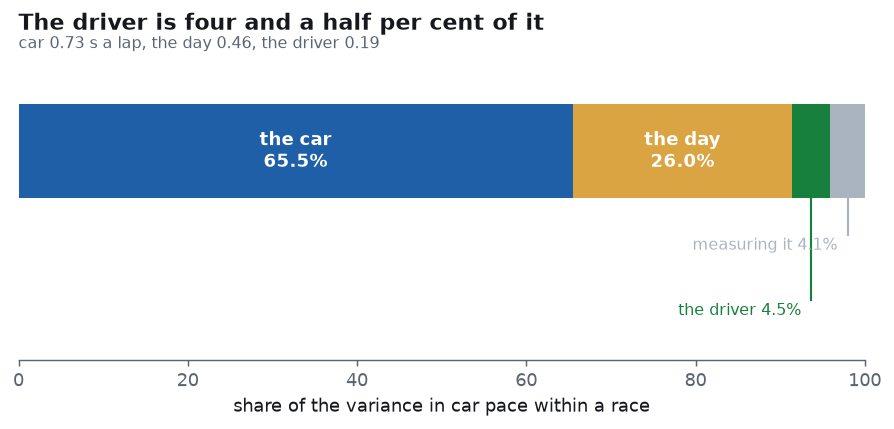
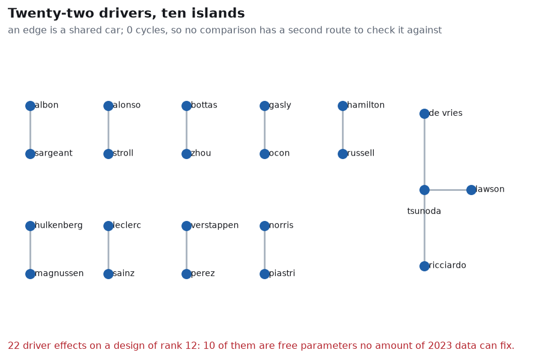
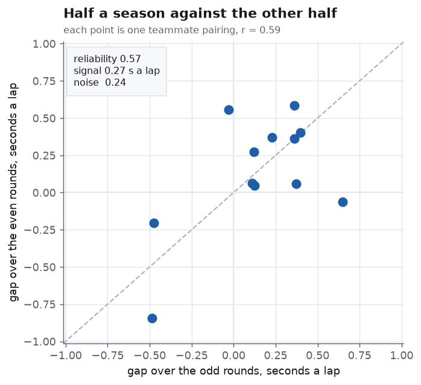
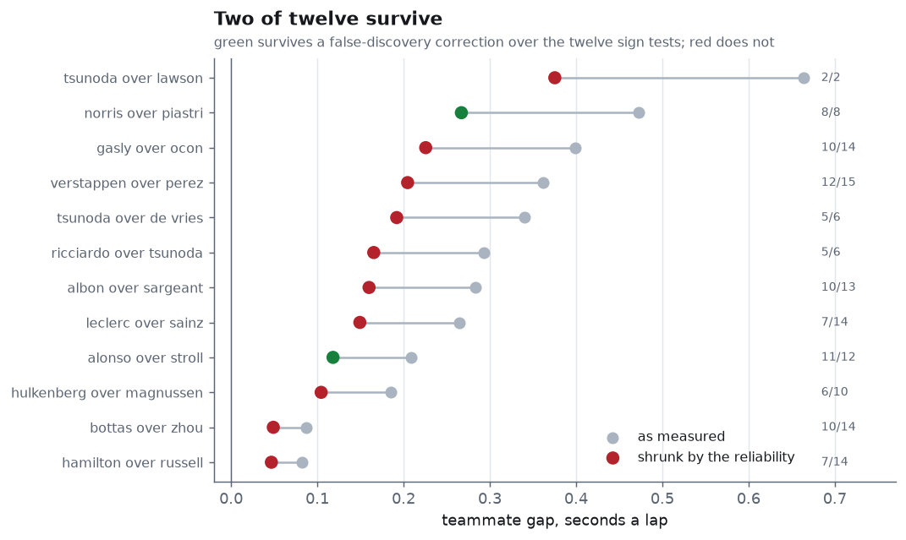
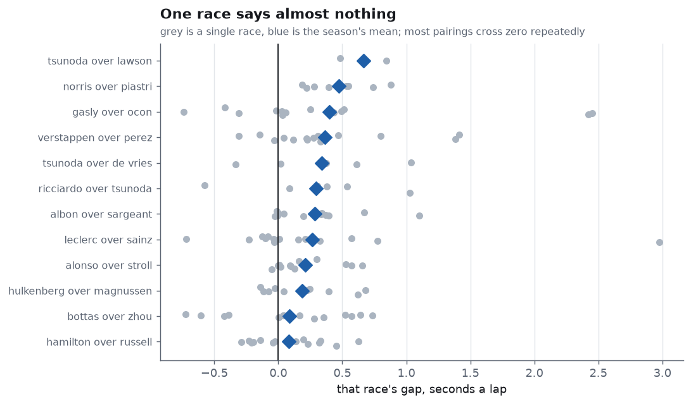
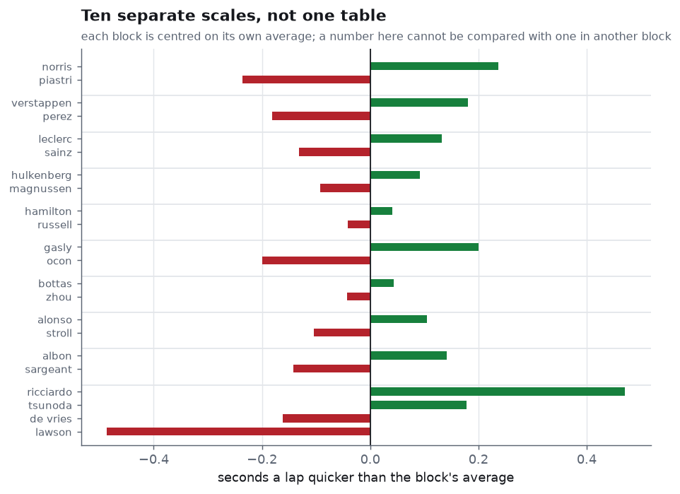

# driver-or-car

**How much of a Formula 1 lap time is the car, and how much is the driver?**

The car, in the 2023 season: **0.732 seconds a lap**. The driver: **0.192**.
A ratio of **3.8 to 1** in seconds and about **15 to 1** in variance.

But the number that changed how I read the season is the third one.
*What happened to a particular car on a particular afternoon* —
damage, a strategy call, a safety car in the wrong place — is
**0.461 seconds a lap**, which is **2.4 times the driver**. The largest
thing a single-season driver ranking is measuring, after the car, is
luck.



| | seconds a lap | share of the variance |
|---|---:|---:|
| the car the team built | 0.732 | 65.5% |
| what happened on the day | 0.461 | 26.0% |
| **the driver** | **0.192** | **4.5%** |
| error in measuring it | 0.182 | 4.1% |

---

## The question before the question

A driver can only be measured against someone who had the same car. So
before measuring anything, draw the graph: drivers are nodes, and an
edge joins two drivers who shared a team in the same race.



22 drivers. 12 pairings. **10 separate components, and 0 cycles.**

A forest on *n* nodes with *c* components has exactly *n − c* edges.
Here 22 − 10 = 12, and there are 12 pairings. The graph is a spanning
forest, which has two consequences that no amount of statistical
machinery removes:

1. **10 of the 22 driver effects are free parameters.** The design
   matrix has rank 12. Ten numbers are not in the data at all, and a
   model that prints 22 of them is printing ten it invented.
2. **No comparison has a second route to check it against.** A cycle
   would let you compare A to B directly and also through C, and
   disagreement between the two would measure how wrong the method is.
   With zero cycles there is no such check anywhere in the season.

`comparison.path("max_verstappen", "hamilton")` returns `None`. There is
no chain of shared cars between them in 2023, and nothing in this
repository will tell you which of them is quicker.

This is why the output is ten small tables rather than one list of 22
drivers. A single ranking would be the interesting part of the answer
made up.

---

## How a comparison is made

One car, two drivers, one afternoon.

Each driver's pace is fitted on their own laps against `[1, tyre age,
lap number]` — tyre age for degradation, lap number for the fuel burning
off — and the difference between the two intercepts is one comparison.

**Laps spent within two seconds of the car ahead are thrown away first.**
Being held up costs about a quarter of a second a lap (measured in the
[pace-to-pass](https://github.com/Pratsss24/pace-to-pass) project), and
that is a property of the traffic, not the driver. 8,193 of the 26,962
usable laps go out on this rule — close to a third of the data, and
keeping them would have credited drivers with whatever the car in front
was doing.

| | laps or races |
|---|---:|
| clean racing laps | 18,769 |
| held out: in traffic | 8,193 |
| team-races seen | 199 |
| **kept: comparisons** | **128** |
| refused: only one driver classified | 21 |
| refused: too few clear laps from one of them | 40 |
| refused: tyre age and lap not separable | 9 |
| refused: a gap too large to be pace | 1 |

The third refusal is worth a sentence. A car that never pitted has tyre
age exactly equal to lap number, so the two columns are the same vector
and no fit can tell degradation from fuel. That is a refusal, not a
number with a wide error bar.

---

## The correction that matters most

The spread of car paces within a race splits into a part between teams
(0.732 s a lap) and a part within a team (0.531 s a lap, over 178
team-races). It is tempting to call the second one "the driver". It is
not.

Within-team differences also contain damage, a strategy call, a lap of
traffic the detector missed, and the ordinary error in fitting a pace to
forty laps. Those do not persist from race to race — and that is exactly
how to separate them.



Measure each pairing's gap on the odd-numbered rounds, then on the
even-numbered rounds, and see whether the two agree.

**r = 0.590, reliability 0.565.**

Barely more than half of what separates one pairing from another comes
back in the other half of the same season, with the same drivers in the
same cars. The signal standard deviation is 0.271 s and the noise 0.238.
A teammate gap is a difference of two driver effects, so its signal
variance is twice a single driver's — hence the driver term of
0.271 / √2 = 0.192. The rest of the within-team spread is the day,
less the 0.182 s a lap that is simply the error in measuring a car's
pace over one race.

Without this step the driver's share comes out at roughly a fifth rather
than a twentieth, and no amount of extra data fixes it, because the bias
does not shrink with the sample.

---

## Every pairing the season supports



| quicker | slower | raw | shrunk | ahead in | p | survives |
|---|---|---:|---:|---:|---:|---|
| tsunoda | lawson | +0.664 | +0.375 | 2/2 | 0.2500 | no |
| norris | piastri | +0.473 | +0.267 | 8/8 | 0.0039 | **yes** |
| gasly | ocon | +0.399 | +0.226 | 10/14 | 0.0898 | no |
| verstappen | perez | +0.362 | +0.205 | 12/15 | 0.0176 | no |
| tsunoda | de vries | +0.340 | +0.192 | 5/6 | 0.1094 | no |
| ricciardo | tsunoda | +0.293 | +0.165 | 5/6 | 0.1094 | no |
| albon | sargeant | +0.283 | +0.160 | 10/13 | 0.0461 | no |
| leclerc | sainz | +0.264 | +0.149 | 7/14 | 0.6047 | no |
| alonso | stroll | +0.209 | +0.118 | 11/12 | 0.0032 | **yes** |
| hulkenberg | magnussen | +0.185 | +0.104 | 6/10 | 0.3770 | no |
| bottas | zhou | +0.087 | +0.049 | 10/14 | 0.0898 | no |
| hamilton | russell | +0.083 | +0.047 | 7/14 | 0.6047 | no |

The **p** column is a sign test: how often was the quicker driver
actually quicker? It needs no model to believe, which is why it is the
column the table is judged on.

Four pairings reach p < 0.05. Twelve tests at five per cent expect about
half a false positive between them, so controlling the false discovery
rate (Benjamini–Hochberg) leaves **two**: norris over piastri
(p 0.0039) and alonso over stroll (p 0.0032). The rest of the table is
a table, not a set of findings.

Notice how the sign test disagrees with the size of the gap. Leclerc's
mean advantage over Sainz is +0.264 s a lap, which looks substantial —
but he was quicker in 7 of 14 races. The mean is being carried by a few
afternoons, which is precisely the pattern the reliability number
already warned about:



**Shrinkage.** Every gap is pulled toward zero by the reliability, so
+0.473 becomes +0.267. A gap measured over a dozen races is partly real
and partly the luck of those dozen races, and James–Stein shrinkage
beats the raw estimates in total squared error. Here it does something
more useful than that: it stops a table of twelve numbers from implying
twelve findings.

---

## Driver effects, in ten separate scales



Seconds a lap **quicker** than the driver's own component's average.
Positive is quicker — the opposite sign to a lap time.

| driver | s a lap |
|---|---:|
| ricciardo | +0.471 |
| tsunoda | +0.178 |
| de vries | −0.162 |
| lawson | −0.486 |

That is the only block with more than two drivers: the four who passed
through the AlphaTauri seats in 2023. Everything else is a pair, where
the two numbers are one comparison written twice.

**Comparing a number here with one from another block is meaningless.**
Each component is centred on its own mean, and nothing in the season
ties one block's zero to another's.

---

## What this does not do

- **It does not rank drivers across teams.** That is the point of the
  graph section, not a limitation discovered afterwards.
- **It says nothing about qualifying.** This is race pace only; a driver
  who is quick over one lap and ordinary over a stint looks ordinary
  here.
- **It cannot separate a driver from the car's suitability to them.** A
  car developed around one driver's preferences flatters that driver,
  and that appears in these numbers as driver skill. No teammate design
  can fix this, because both drivers are in the same car.
- **One season.** That is why the race-to-race term is as large as it
  is. Several seasons would shrink it and would also, by adding driver
  moves, put cycles in the graph.
- **No tyre compound.** The source does not record one, so a stint on
  softs and a stint on hards enter the same degradation term.
- **Finishing position is not modelled at all.** Only clean-air race
  pace.

---

## What I got wrong

**The first decomposition gave a car-to-driver ratio of 1.8.** That was
far too small, and I nearly published it. The within-team spread was
being labelled "driver" wholesale, which quietly counted every race
accident and strategy call as skill. Deriving the driver term from the
split-half signal instead moved the ratio to 3.8. The code that did this
is `effects.persistent`; the function it replaced was called `corrected`,
and the name was the most accurate thing about it.

**The driver effects came out with the sign inverted.** `fit_effects`
negated its coefficients, so the quicker driver appeared as a negative
number under a caption saying positive is quicker. The design matrix
already carries +1 in the quicker slot; the negation was a reflex from
thinking of lap times. There is now a test named
`test_positive_is_quicker_which_is_the_opposite_sign_to_a_lap_time`.

**The race-to-race term was initially unchecked against its own
measurement error.** A term that turned out to be mostly the error in
measuring it would be worth nothing. `car_pace` now returns the median
standard error of a car's pace in a race (0.182 s a lap) and that
variance is subtracted out separately, so 26.0% is what is left after
the measurement is accounted for rather than before.

---

## Running it

```bash
pip install -r requirements.txt
python run.py
```

The 2023 season is cached in `data/season_2023.json`, so it runs offline
and a second run costs nothing. Output goes to `out/`: six PNGs and a
printable `report.pdf`.

```bash
python -m pytest tests -q
```

33 tests. They check algebra with one right answer (a forest's edge
count, the design's rank, centring summing to zero), recovery of planted
truths from synthetic lap times, and that every measurement which cannot
be made is refused and counted rather than returned as a number. No test
compares against saved output — a golden file only proves the code still
does what it did.

---

## Layout

| file | what is in it |
|---|---|
| `src/data.py` | fetch and cache the season from the Jolpica/Ergast API |
| `src/stints.py` | laps into stints, with tyre age and the cleaning rules |
| `src/gaps.py` | cumulative lap times, which is where gaps come from |
| `src/follow.py` | who was within two seconds of whom, per lap |
| `src/graph.py` | the comparison graph: components, cycles, rank, design |
| `src/contrast.py` | one teammate comparison per team-race, and the refusals |
| `src/effects.py` | car pace, the variance split, shrinkage, sign test, FDR |
| `src/linear.py` | OLS with Liang–Zeger cluster-robust errors |
| `src/charts.py` | the six figures |
| `src/report.py` | the printable PDF report |
| `src/paper.py` | page composition: A4 pages, tables, figure bands |
| `run.py` | the pipeline, start to finish |

---

## Fachbegriffe

| English | Deutsch |
|---|---|
| comparison graph | Vergleichsgraph |
| connected component | Zusammenhangskomponente |
| spanning forest | aufspannender Wald |
| cycle | Zyklus |
| identifiability | Identifizierbarkeit |
| free parameter | freier Parameter |
| rank (of a matrix) | Rang |
| variance decomposition | Varianzzerlegung |
| nested analysis of variance | hierarchische Varianzanalyse |
| between-group variance | Varianz zwischen den Gruppen |
| within-group variance | Varianz innerhalb der Gruppen |
| split-half reliability | Split-Half-Reliabilität |
| measurement error | Messfehler |
| attenuation | Abschwächung |
| shrinkage estimator | Schrumpfungsschätzer |
| sign test | Vorzeichentest |
| false discovery rate | Falscherkennungsrate |
| multiple testing | multiples Testen |
| cluster-robust standard error | clusterrobuster Standardfehler |
| fixed effect | fester Effekt |
| collinearity | Kollinearität |
| tyre degradation | Reifenabbau |
| dirty air | gestörte Luftströmung |
| clean air | freie Luft |
| lap time | Rundenzeit |
| teammate | Teamkollege |

---

## Data

Lap times, pit stops and results from the [Jolpica](https://api.jolpi.ca)
mirror of the Ergast schema, 2023 season: 24,386 lap times and 440 race
entries over 22 rounds. The cleaning rules are carried over from
[stint-degradation](https://github.com/Pratsss24/stint-degradation),
[undercut-effect](https://github.com/Pratsss24/undercut-effect) and
[pace-to-pass](https://github.com/Pratsss24/pace-to-pass).
